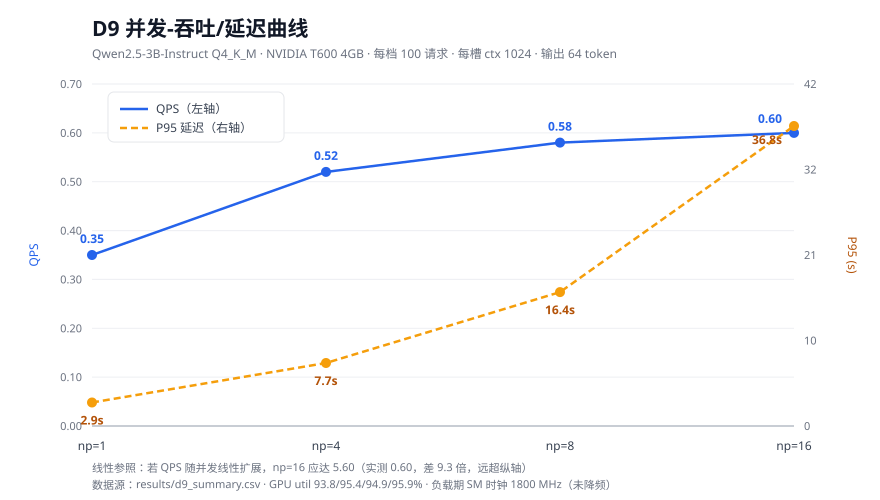

# 第三章 · 并发与瓶颈（D9）

> 数字纪律：本章所有数值只来自 `results/d9_summary.csv` 与 `results/d9_level_meta.csv`（2026-11-18 本机实测，WSL + NVIDIA T600 4 GB）。派生列（平均延迟、在途请求、MFU）由 `results/d9_requests.csv` 原始逐笔数据算出，公式在本章给出。

## 3.1 口径（别人追问第一个问题就是「你怎么测的」）

| 项 | 值 |
|---|---|
| 服务端 | `llama-server` b12033，CUDA 13.3，`-ngl 36 -t 8 -b 512 -ub 256 --no-warmup` |
| 并发方式 | `-np N`，`-c = N × 1024`（**每槽上下文固定 1024**），日志 `n_ctx_slot` 逐档校验 |
| 模型 | Qwen2.5-3B-Instruct Q4_K_M（2,104,932,768 B） |
| 请求 | `/v1/completions`，`stream=true`，`ignore_eos=true`，`max_tokens=64`，`temperature=0`，`cache_prompt=false` |
| Prompt | 同一段模板 + 每请求随机 nonce 前缀；实测 **prompt_n 中位 140**（无截断，逐笔 CSV 可核） |
| 样本量 | 每档 100 笔；命中前先热身 4 笔，不计入 |
| 采样 | 客户端 200 ms 一采 `nvidia-smi`（GPU util / 显存 / 显存 util），同时读 `/proc/stat` 算整机 CPU |
| 分位算法 | 最近秩法，不插值（n=100 时 P95 = 第 95 个样本） |
| 硬件 | T600 4 GB，128-bit，官方带宽 160 GB/s，FP32 1.7 TFLOPS，`clocks.max.sm = 2100 MHz` |

> 为什么每槽 ctx 必须固定：`llama-server` 把 `-c` 按 `-np` 均分。`-np 16 -c 4096` 时每槽只剩 256，140 token 的 prompt 就被截断，四档不再是同一个实验。日志里 `n_ctx_slot` 是唯一证据。

**执行备注（诚实记录）**：np=1、np=4 首轮一次跑通；np=8 这一档两次在约 19.6 s 处被整组 `SIGTERM`（服务端日志 `cancel task ... cleaning up before exit`，进程组连同客户端一起消失，逐请求 CSV 未落盘），第三次改在**同一个前台 WSL 会话**内重跑成功，本章 np=8/np=16 数据取自该次重跑，`d9_requests.csv` 共 400 笔全成功。

## 3.2 先算天花板（压测前就该有的预期）

| 项 | 算法 | 数 |
|---|---|---|
| 权重读取 / step | 2.105 GB ÷ 160 GB/s | 13.2 ms → 带宽侧单流上限 **76 tok/s** |
| 单流实测（本次） | TPOT 中位 27.7 ms | **36.1 tok/s**，有效带宽 2.105 GB / 27.7 ms ≈ **76 GB/s（规格 47%）** |
| 单流锚点（D2） | 39.33 tok/s | 与本次同一量级，说明 np=1 没被降频拖累 |
| 算力侧理论 | 6.18 GFLOP/token ÷ 1.7 TFLOPS | **275 tok/s**（100% MFU 的假设） |
| 算力侧实测上限 | 见 3.3「单卡有效算力」列 | 44% MFU ≈ **121 tok/s**（prefill+decode 混算） |
| 结论 | min(带宽×N, 算力) | 理论上限约单流 7 倍；**实测 1.7 倍**，差在哪见 3.5 |

> 关键修正：压测前按 100% MFU 估的 274 tok/s 是纸面峰值。实测这张卡在 16 并发下也只跑到 **44% MFU**，所以真实天花板是 ~121 tok/s，不是 275。

## 3.3 并发-延迟曲线

| 并发 | 每槽 ctx | QPS | P50(ms) | P95(ms) | TTFT P95(ms) | 聚合 tok/s | 错误率 | 显存峰值(基线) MiB | GPU util 均值 | 扩展效率 |
|---|---|---|---|---|---|---|---|---|---|---|
| 1 | 1024 | 0.35 | 2873 | 2884 | 1131 | 22.3 | 0.00% | 2464 (2452) | 93.8% | 1.00 |
| 4 | 1024 | 0.52 | 7676 | 7736 | 4296 | 33.5 | 0.00% | 2572 (2556) | 95.4% | 0.37 |
| 8 | 1024 | 0.58 | 13809 | 16446 | 4426 | 36.9 | 0.00% | 2698 (2694) | 94.9% | 0.21 |
| 16 | 1024 | 0.60 | 26479 | 36841 | 15161 | 38.2 | 0.00% | 2976 (2969) | 95.9% | 0.11 |

派生指标（同一批逐笔数据算出，面试时用来「一句话定性」）：

| 并发 | 平均延迟(ms) | 在途请求 = QPS×平均延迟 | TPOT 中位(ms) | 按 TPOT 折算生成速率(tok/s) | 单卡有效算力(GFLOP/s) | MFU（对 1.7 TFLOPS） |
|---|---|---|---|---|---|---|
| 1 | 2867 | **1.0** | 27.7 | 36.1 | 439 | 26% |
| 4 | 7643 | **4.0** | 60.2 | 66.4 | 659 | 39% |
| 8 | 13688 | **7.9** | 167.0 | 47.9 | 727 | 43% |
| 16 | 26342 | **15.7** | 366.4 | 43.7 | 752 | 44% |

读法三条：

1. **在途请求 ≈ 并发数（1.0 / 4.0 / 7.9 / 15.7）**：利特尔法则反查，说明槽位始终被占满，客户端没串行、也没空转。曲线不是「没打满」，是「打满了也就这么快」。
2. **TPOT 与并发的乘积先升后降**：36.1 → 66.4 → 47.9 → 43.7 tok/s。4 并发是甜点；8 并发起，每个 step 里混进 140-token 的 prefill，decode token 被推迟，单请求 TPOT 从 60 ms 涨到 366 ms。
3. **TTFT P95 从 1131 ms 跳到 15161 ms**：排队时间几乎全压在 prefill 段（TTFT 含排队，TPOT 不含），这是 P50 涨 9.2 倍而 QPS 只涨 1.71 倍的直接原因。

## 3.4 瓶颈判定（三选一，必须给证据）

| 候选 | 证据长什么样 | 实测是否命中 |
|---|---|---|
| GPU 侧饱和（算力/带宽） | GPU util ≥ 92%，且扩展效率在 4→8 就明显掉 | **命中**：util 93.8–95.9%，效率 1.00→0.37→0.21→0.11 |
| 主机 CPU 先满 | GPU util < 70%，整机 CPU ≥ 80%，`t` 线程超订 | 不命中：整机 CPU 仅 14.7–30.3% |
| 批调度上限 / prefill 抢占 | GPU 未满、CPU 未满，但 np 8→16 的 QPS 几乎不动 | 部分命中：0.58→0.60，但同时 GPU 已 95.9% |

判定理由（可复述的一段话）：

> np 从 1 到 16，QPS 只从 0.35 到 0.60（1.71 倍），同期 GPU util 从 93.8% 到 95.9%、整机 CPU 从 30.3% 降到 14.7%、错误率恒为 0，在途请求始终等于并发数——**瓶颈在 GPU 侧，不在客户端、不在 CPU、不在排队不满**。进一步定位到「算力」而不是「带宽」：np=16 时一个 decode step 要 366 ms 才推进 16 个 token，折算权重读取只有 5.7 GB/s（规格 160 GB/s 的 3.6%），显存带宽根本没用满，卡是在算而不是在等数据。证据：`results/d9_level_meta.csv` 的 `gpu_util_avg / cpu_busy_avg` 两列、`results/d9_requests.csv` 的 `tpot_ms`，以及 `results/d9_clocks.csv`（负载期 1800 MHz，非降频）。

## 3.5 为什么吞吐不线性涨（面试原题）

四层原因，按「能不能改变」排序，每层都带数：

1. **每请求的工作量是固定的，加并发不生产 FLOPs。**
   140 prompt + 64 output ≈ 204 token × 6.18 GFLOP ≈ **1.26 TFLOP/请求**，100 笔合计 **≈126 TFLOP**。单卡 FP32 峰值 1.7 TFLOPS → 理论最短 74 s；实测墙钟 168 s（np=16）→ **MFU 44%**。这意味着就算并发无穷大，100 笔也快不过 74 s。扩展效率 0.11 不是「没调好」，是「单卡就这么多算力」。

2. **np=1 时是带宽受限，并发一上来带宽就不再是瓶颈。**
   单流每个 token 读一遍 2.105 GB 权重：27.7 ms → 76 GB/s（规格 47%，GEMV 效率本来就低）。16 并发时一次 step 读同一份权重却出 16 个 token：366 ms → 5.7 GB/s。**瓶颈从「搬运」换成了「计算+调度」**，这也解释了为什么「带宽天花板 76 tok/s」的预期在 16 并发下不成立——带宽上限被 batching 摊薄了，算力上限没被摊薄。

3. **prefill 抢占是 8→16 档 QPS 几乎不动的主因。**
   prompt 140 token 占每请求 token 总量的 69%。每个新请求进来都要先吃 140 token 的 prefill，这段和别人的 decode 挤同一个 `-ub 256` 批：TTFT P95 从 1131 ms（np1）→ 4296（np4）→ 4426（np8）→ **15161 ms（np16）**，而 TPOT 折算的生成速率反而从 66.4 掉到 43.7 tok/s。也就是说高并发下 GPU 的时间被 prefill 吃掉，用户看到的「变慢」主要是排队等 prefill，不是 decode 本身变慢。

4. **批上限与 KV 是次要项，但会在更大规模先撞墙。**
   `-ub 256`：16 并发时每 step 最多 16 个 decode token + 240 个 prefill token，prefill 块几乎吃满 ubatch——这正是第 3 条的机制来源。KV 侧：16 × 1024 × 36 KiB = **576 MiB 预分配**，每 step 活跃 KV 约 16 × 200 × 36 KiB ≈ 112 MiB，只占权重读取的 5.3%，目前不是瓶颈；但 `-c` 随 np 线性长，32 并发、长上下文时要重新算。

**一句话版本（可直接背）**：这张卡单流 36 tok/s 时已经吃掉 47% 的显存带宽，加并发把权重读取摊薄了，于是瓶颈换成算力——而 100 笔请求的总 FLOPs 是固定的 126 TFLOP，1.7 TFLOPS 的卡就算 100% 利用率也要 74 s，实测 44% MFU 就是 168 s；再往上加并发只能把 P50 从 2.9 s 推到 26.5 s，QPS 停在 0.60。

## 3.6 本章结论（三句话，每句带数）

1. 单流 36.1 tok/s → np=16 聚合 38.2 tok/s（QPS 0.35 → 0.60，放大 1.71 倍），扩展效率 1.00 / 0.37 / 0.21 / 0.11，**曲线在 np=4 之后基本躺平**。
2. P95 从 2884 ms 涨到 36841 ms（12.8 倍），P50 涨 9.2 倍——延迟涨幅远大于吞吐涨幅，这是排队（TTFT P95 15.2 s）而不是算得慢。
3. 瓶颈是 **GPU 算力**（util 95.9%、MFU 44%、CPU 仅 14.7%、带宽只用 3.6%）；换 vLLM 不会改变「单卡 126 TFLOP 要 168 s」这条硬账，只会改善调度与显存碎片，把第 2 条的斜率压下来。

## 3.7 已知限制（写清比藏着强）

- 客户端与服务器同机（WSL）：16 并发时客户端 CPU 累计 1.31 s，仅占墙钟 168 s 的 0.8%，可忽略；np=1 档客户端 CPU 2.97 s 占 1.0%，同样可忽略。
- 显存峰值含桌面基线（514–531 MiB），表中已同时给出基线与峰值，只应引用差值（np16 峰值−基线 ≈ 2462 MiB）。
- 四档 `-c` 不同（1024×np），显存峰值的上涨里有一部分是 KV 预分配（np16 预分配 576 MiB），不是负载本身。
- prompt 实测中位 140 token，比方案里假设的 200 短；prefill 占比因此比原预期低一些（69% 的 token 是 prefill），若换更长 prompt，第 3 条会更严重。
- 全程 `power.draw` 在 WSL 下返回 `[N/A]`，无法给功耗证据；时钟用 `clocks.sm` 替代（负载期稳定 1800 MHz，未触发降频）。